# 1. Verificación del cifrado del portatil y la partición del servidor


Después de completar todos los pasos, la configuración del servidor queda de la siguiente manera:

| Elemento                 | Configuración                   |
| ------------------------ | -------------------------------- |
| Servidor                 | Ubuntu Server                    |
| Disco secundario         | `/dev/vdb`                     |
| Tamaño del disco        | 4 GB                             |
| Partición               | `/dev/vdb1`                    |
| Tipo de cifrado          | LUKS2                            |
| Dispositivo desbloqueado | `/dev/mapper/clientes_cifrado` |
| Sistema de archivos      | EXT4                             |
| Punto de montaje         | `/clientes`                    |

### Estructura final

```text
/dev/vdb
    |
    └── /dev/vdb1
            |
            └── LUKS2
                  |
                  └── /dev/mapper/clientes_cifrado
                            |
                            └── EXT4
                                  |
                                  └── /clientes
```

### Conclusión

Se ha configurado correctamente el segundo disco del servidor Ubuntu Server para almacenar los documentos de los clientes.

Se ha creado una partición de 4 GB, se ha protegido mediante cifrado LUKS2, se ha creado un sistema de archivos EXT4 y se ha montado en el directorio `/clientes`.

Las comprobaciones realizadas con `lsblk`, `df -h` y `cryptsetup status` confirman que la partición está cifrada, desbloqueada y montada correctamente.

**Nota final:** El montaje realizado es temporal. Si se reinicia el servidor, será necesario volver a desbloquear el volumen e iniciar el montaje. Para automatizar este proceso habría que configurar `/etc/crypttab` y `/etc/fstab`.

## Verificación Portatil

La verificación consiste en comprobar que nos pide una contraseña para el cifrado el encender la máquina virutal y que el usuario para Laura está creado con su propia contraseña.

Al finalizar el ejercicio se obtiene una máquina virtual con las siguientes características:

| Elemento | Configuración |
|---|---|
| Plataforma de virtualización | QEMU |
| Entorno de virtualización | GNS3 |
| Sistema operativo | Ubuntu Desktop 22.04.5 LTS |
| Gestor de volúmenes | LVM |
| Sistema de cifrado | LUKS |
| Usuario creado | Laura |
| Nombre de usuario | laura |
| Clave de seguridad | Contraseña LUKS |ç
| Clave de usuario | Contraseña segura |
| Clave adicional | Clave de recuperación |

### Esquema de funcionamiento

```text
          MÁQUINA VIRTUAL QEMU
                  |
                  |
          DISCO VIRTUAL
                  |
                  |
             CIFRADO LUKS
                  |
                  |
                 LVM
                  |
                  |
          VOLÚMENES LÓGICOS
                  |
                  |
           SISTEMA UBUNTU
                  |
                  |
          USUARIO: LAURA
   
```

---

### Conclusión

Se ha realizado la instalación de Ubuntu Desktop 22.04.5 LTS en una máquina virtual QEMU dentro de GNS3.

Durante la instalación se ha seleccionado el uso de LVM y el cifrado mediante LUKS para proteger los datos almacenados en el disco virtual.

También se ha configurado una contraseña de seguridad para desbloquear el disco y se ha activado la opción de generar una clave de recuperación.

Finalmente, se ha creado la cuenta de usuario de Laura con su contraseña segura correspondiente.

El resultado es una instalación de Ubuntu con almacenamiento cifrado, preparada para proteger la información en caso de pérdida o acceso no autorizado a la máquina virtual.

# Luis

## Medida: Comprobar las protecciones del sistema y confinar un servicio

**Equipo:** `srv-mareas` (Ubuntu 24.04.5 LTS, kernel 6.8) · **Implanta:** Luis Baena · **Comprueba:** Raúl

### 1. Punto de partida: qué traía el sistema

Antes de cambiar nada, revisamos 17 parámetros de protección del núcleo:

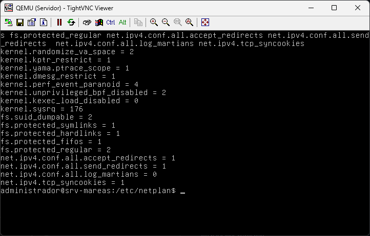

| Parámetro | De serie | Estado |
|---|---|---|
| `kernel.randomize_va_space` | 2 |  Ya protege (ASLR completo) |
| `kernel.dmesg_restrict` | 1 |  Ya protege |
| `kernel.perf_event_paranoid` | 4 |  Ya protege |
| `kernel.unprivileged_bpf_disabled` | 2 |  Ya protege |
| `fs.protected_symlinks` / `hardlinks` | 1 / 1 |  Ya protege |
| `fs.protected_regular` | 2 |  Ya protege |
| `net.ipv4.tcp_syncookies` | 1 |  Ya protege |
| `kernel.kptr_restrict` | 1 |  Parcial |
| `kernel.yama.ptrace_scope` | 1 |  Parcial |
| `kernel.kexec_load_disabled` | 0 |  Abierto |
| `kernel.sysrq` | 176 |  Abierto |
| `fs.suid_dumpable` | 2 |  Abierto |
| `net.ipv4.conf.all.accept_redirects` | 1 |  Abierto |
| `net.ipv4.conf.all.send_redirects` | 1 |  Abierto |
| `net.ipv4.conf.all.log_martians` | 0 |  Abierto |

Ningún servicio expuesto venía confinado: AppArmor está activo, pero `vsftpd`, `nginx` y `smbd` aparecen como `unconfined`.

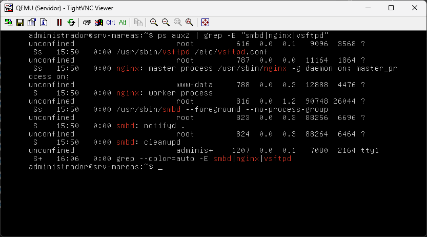

### 2. Núcleo: parámetros cerrados de forma permanente

Los 8 parámetros abiertos se fijan en un fichero propio, `/etc/sysctl.d/99-mareas.conf` (los motivos están en `decisiones.md`, D-L1), y se aplican con `sudo sysctl --system`.

Tras reiniciar el servidor, los 8 mantienen el valor nuevo:

| Parámetro | Esperado | Obtenido |
|---|---|---|
| `kernel.kptr_restrict` | 2 | 2  |
| `kernel.yama.ptrace_scope` | 2 | 2  |
| `kernel.kexec_load_disabled` | 1 | 1  |
| `kernel.sysrq` | 0 | 0  |
| `fs.suid_dumpable` | 0 | 0  |
| `net.ipv4.conf.all.accept_redirects` | 0 | 0  |
| `net.ipv4.conf.all.send_redirects` | 0 | 0  |
| `net.ipv4.conf.all.log_martians` | 1 | 1  |

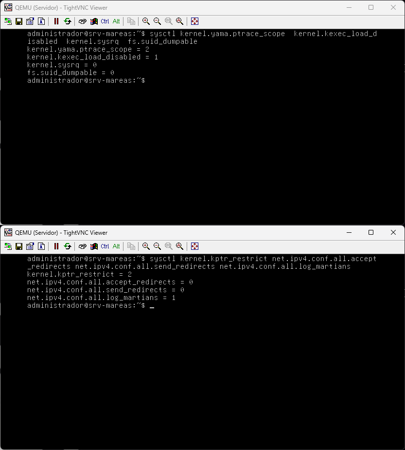

**Incidencias encontradas al comprobar:**
- Una errata en el nombre (`kexec_load_disablde`) impedía aplicar ese parámetro. Se detectó comprobando su valor y se corrigió.
- Tras el primer reinicio, `fs.suid_dumpable` volvía a valer 2 porque Apport lo restablece al arrancar. Se desactivó Apport (`decisiones.md`, D-L2) y, tras el siguiente reinicio, el valor se mantiene a 0.

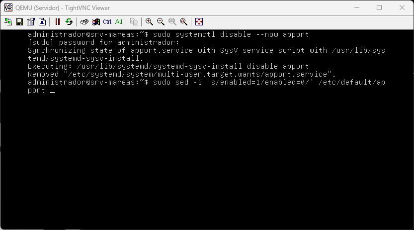

### 3. Confinamiento de Samba (`smbd`)

Antes de confinarlo, revisamos la configuración con `testparm -s`: la carpeta compartida es `/srv/gestoria/clientes`, no hay recurso `[homes]` y `[printers]` usa `/var/tmp`. Con eso se decidieron las rutas de escritura permitidas.

El confinamiento se aplica con un drop-in en `/etc/systemd/system/smbd.service.d/confinamiento.conf`, que no toca el servicio original (motivos en `decisiones.md`, D-L3 y D-L4). `systemctl status smbd` muestra el drop-in cargado y el servicio `active (running)`.

**Nivel de exposición, antes y después:**

| Antes | Después |
|---|---|
| **9.6 UNSAFE** | **6.0 MEDIUM** |

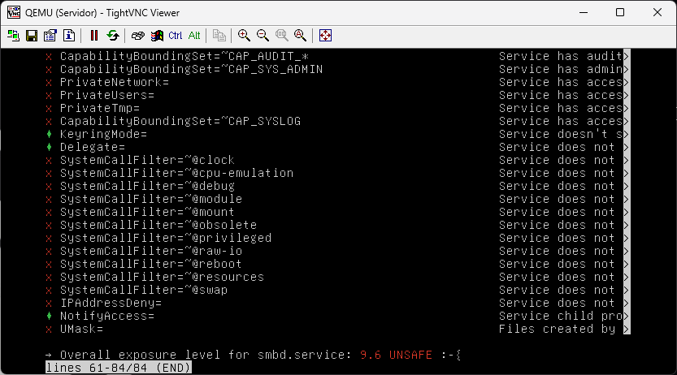
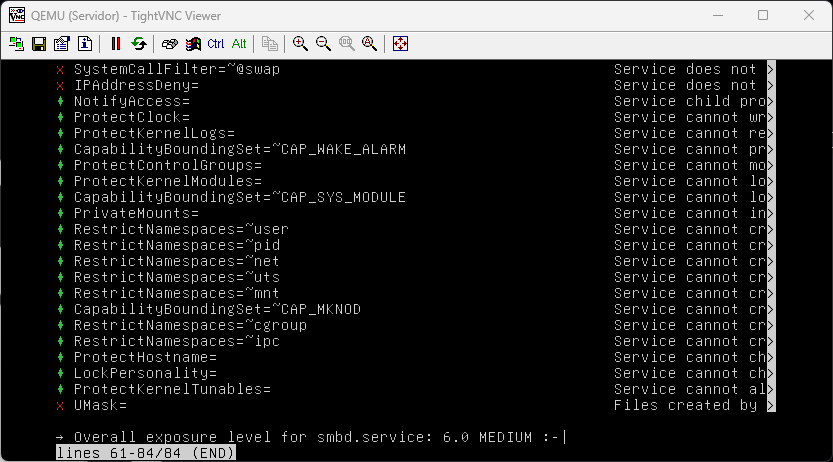

**Bloquea una acción.** Antes del confinamiento, un proceso dentro del espacio de Samba podía crear ficheros en `/etc`. Después:

| Prueba | Resultado |
|---|---|
| `nsenter -t <PID smbd> -m touch /etc/prueba-luis` | `Read-only file system` → **bloqueado** |
| `nsenter -t <PID smbd> -m ls /home` | Vacío: Samba no ve las carpetas personales |

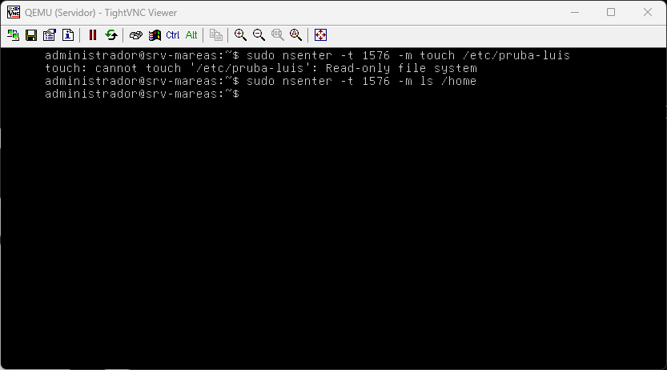

### 4. La gestoría sigue trabajando

Con Samba ya confinado, se crea una carpeta en el recurso de clientes, se lista y se borra sin errores:

```bash
smbclient //127.0.0.1/clientes -N -c "mkdir prueba-luis; ls; rmdir prueba-luis"
```

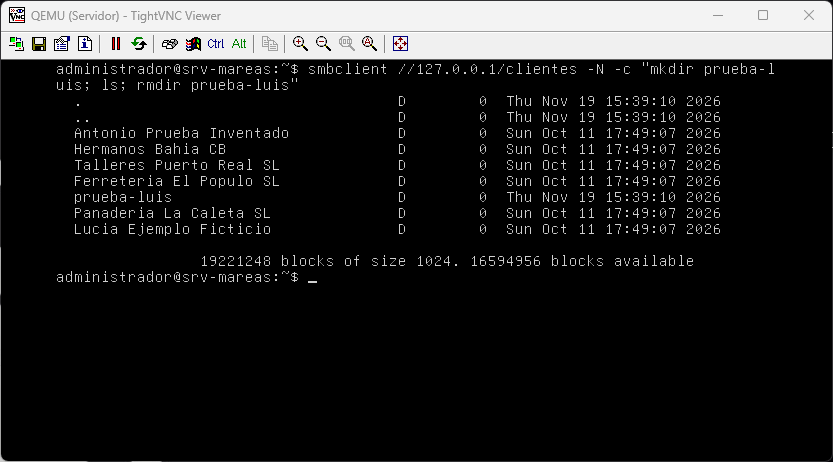

Tras reiniciar el servidor se repitieron las pruebas con el mismo resultado: el drop-in se carga, la escritura en `/etc` sigue bloqueada y la carpeta de clientes sigue accesible.

---

## Medida: Proteger el acceso a BIOS/UEFI y el arranque

**Equipos:** `srv-mareas` y `Portatil` · **Implanta:** Luis Baena · **Comprueba:** Hugo

### 1. Punto de partida (igual en los dos equipos)

| Comprobación | Resultado |
|---|---|
| `GRUB_TIMEOUT_STYLE` / `GRUB_TIMEOUT` | `hidden` / `0`: el menú está oculto, pero aparece pulsando una tecla |
| `GRUB_DISABLE_RECOVERY` | Comentado: **modo recuperación activo** (shell de root sin contraseña) |
| `superusers` / `password` en `grub.cfg` | Nada: **GRUB sin contraseña** |

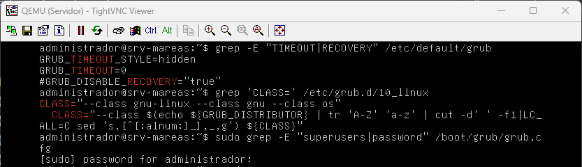

Las dos máquinas virtuales arrancan con **BIOS clásica (SeaBIOS)**, no con UEFI: no existe `/sys/firmware/efi` y en GNS3 la opción *Enable UEFI boot mode* está desactivada. SeaBIOS no permite contraseña de setup, así que la contraseña de BIOS queda documentada para el equipo real (`decisiones.md`, D-L5).

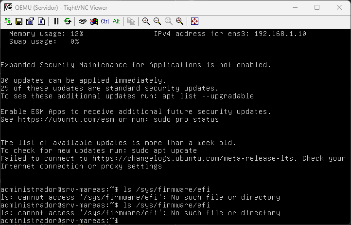

### 2. Configuración aplicada en GRUB (servidor y portátil)

1. Superusuario `admingrub` con la contraseña cifrada (PBKDF2) en `/etc/grub.d/40_custom`. La contraseña es distinta en cada equipo.
2. `--unrestricted` en las entradas normales de Ubuntu (`/etc/grub.d/10_linux`).
3. `GRUB_DISABLE_RECOVERY="true"` en `/etc/default/grub`.
4. Solo en el portátil: se retiran del menú las entradas de memtest86+.
5. `sudo update-grub`.

En `grub.cfg` aparecen `superusers` y `password_pbkdf2`, las entradas de Ubuntu llevan `--unrestricted` y no hay ninguna entrada de recuperación. El hash de la contraseña está tapado en la captura.

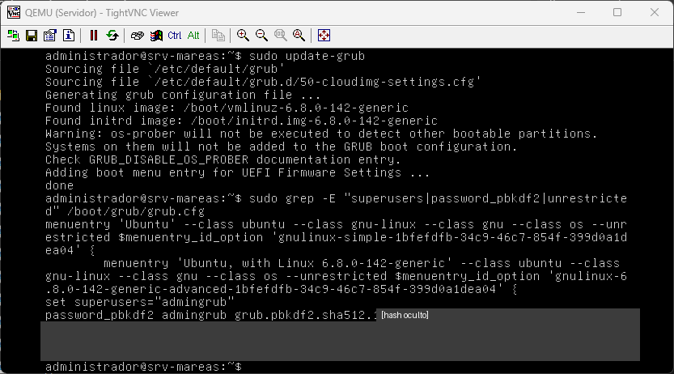

### 3. GRUB protege lo que no es el arranque normal

Al intentar editar una entrada (`e`) o arrancar una entrada no habitual, GRUB pide usuario y contraseña. Con credenciales incorrectas vuelve al menú sin dejar hacer nada; con las correctas se abre el editor. Se probó en los dos equipos con el mismo resultado.

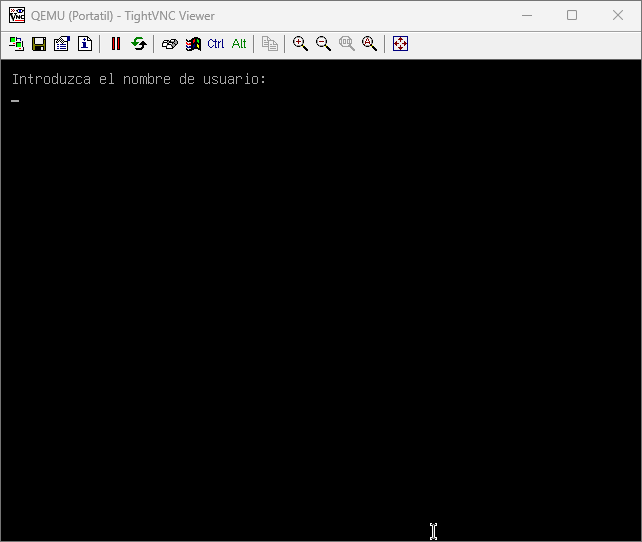

### 4. El arranque normal no pide nada

- **Servidor:** se reinicia sin tocar nada y llega solo al login. Samba sigue dando servicio.
- **Portátil:** GRUB pasa sin pedir nada y lo siguiente que aparece es la petición de la clave LUKS (`Please unlock disk vda4_crypt`). Esto confirma además que `/boot` no va cifrado, y por eso la contraseña de GRUB es necesaria también con el disco cifrado (`decisiones.md`, D-L8).

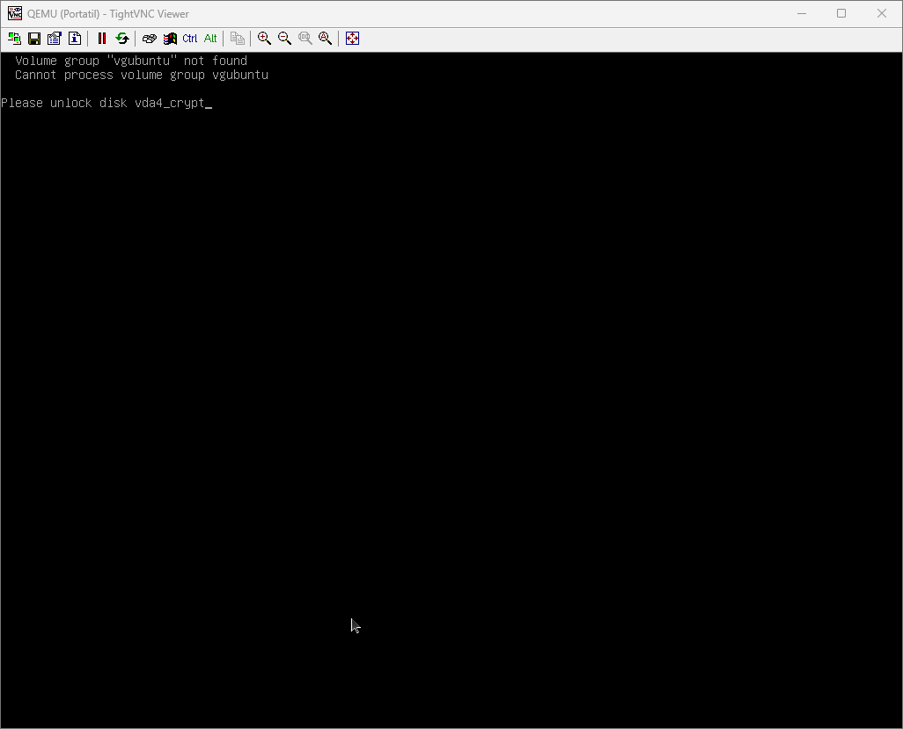

### 5. Arranque solo desde disco (GNS3)

| Ajuste | Servidor | Portátil |
|---|---|---|
| Boot priority | `HDD` (ya venía así) | `HDD` |
| Unidad de CD | Vacía | Vacía |
| Options | `-boot menu=off,strict=on` | `-vga qxl -boot menu=off,strict=on` |
| ¿Arranca después del cambio? | Sí ✅ | Sí ✅ |

`menu=off` desactiva el menú de arranque de la BIOS y `strict=on` impide que intente arrancar desde otro dispositivo si el disco falla.

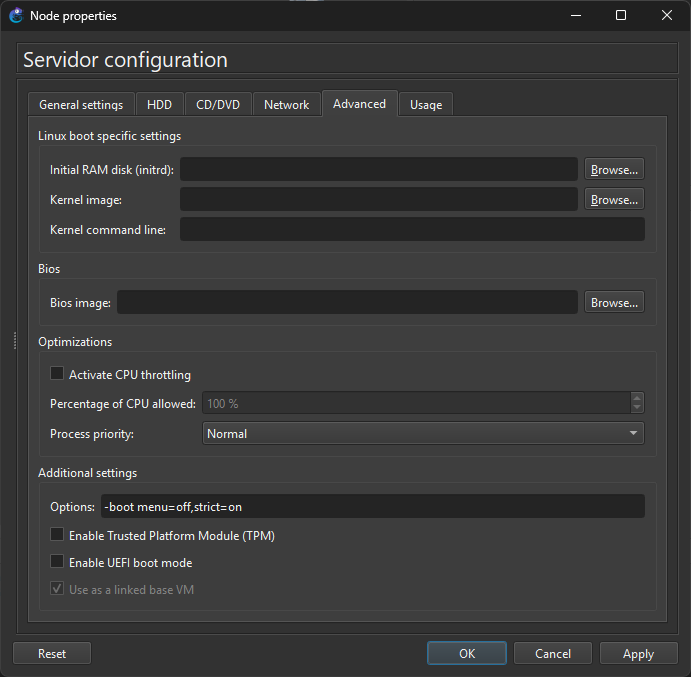

No se pudo probar a arrancar con una ISO, porque el servidor GNS3 no tiene ninguna imagen ISO disponible. En el equipo real, la prueba sería conectar un USB con Kali y comprobar que el equipo arranca igualmente desde su disco.

### 6. La gestoría sigue trabajando

- El servidor arranca sin intervención y Samba sigue sirviendo la carpeta de clientes.
- Laura arranca su portátil igual que antes: solo la clave de LUKS (medida de cifrado) y su login.
- Ninguna de estas medidas cambia la forma de trabajar de la plantilla.

---

# Revisar el acceso desde Internet y acotar el servicio FTP del router

## 7. Verificación del FTP limitado desde Internet

**Equipo de origen:** `Asesoria-fiscal` (`192.168.122.50`).

**Prueba 1: acceso desde la dirección autorizada.**

Desde `Asesoria-fiscal` se comprobó el puerto FTP del router:

```bash
curl -v telnet://192.168.122.51:21
```

Resultado:

```text
* Connected to 192.168.122.51 (192.168.122.51) port 21
220 (vsFTPd 3.0.5)
```

La dirección autorizada recibió el banner de `vsftpd`, por lo que el canal de control TCP/21 estaba accesible.


**Prueba 2: bloqueo desde una dirección no autorizada.**

Se asignó temporalmente `192.168.122.99/24` a `Asesoria-fiscal`, se volvió a probar el puerto 21 y se retiró la dirección.

```bash
ip addr add 192.168.122.99/24 dev eth0
curl --interface 192.168.122.99 -m 3 -v telnet://192.168.122.51:21
ip addr del 192.168.122.99/24 dev eth0
```

Resultado: la conexión fue rechazada con `Connection refused`.

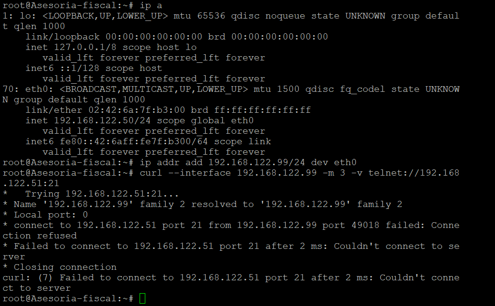

**Prueba 3: transferencia en modo pasivo.**

```bash
curl -v --ftp-pasv --user asesoriafiscal ftp://192.168.122.51/
```

El servidor respondió `230 Login successful` y permitió listar archivos. Negoció el puerto pasivo `40036`, dentro del rango `40000-40050` configurado en el router.

**Configuración verificada en el router:**

- Las reglas Destination NAT permiten TCP/21 y TCP/40000-40050 solamente desde `192.168.122.50`.
- Las reglas de forward permiten las sesiones establecidas y relacionadas.
- Los servicios Telnet, FTP, API y API-SSL están deshabilitados.
- WWW, SSH y Winbox están limitados a las redes de administración VLAN 10 y VLAN 20.

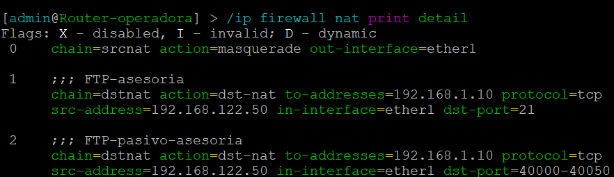
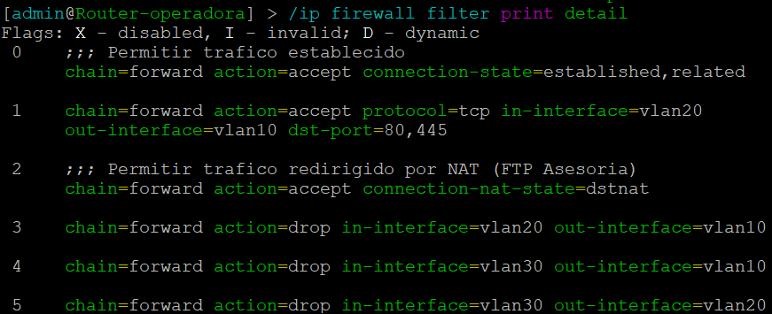


# Eliminar la cuenta del becario y limitar privilegios

## 8. Verificación de la eliminación de la cuenta `becario`

**Equipo comprobado:** `srv-mareas`.

Se comprobó que la cuenta ya no existía y que no quedaba una entrada de sudoers específica para ella:

```text
id becario
id: becario: no such user

ls /etc/sudoers.d
README
```

Resultado:

- La cuenta `becario` no existe.
- No aparece ningún archivo `becario` en `/etc/sudoers.d`.
- El acceso administrativo asociado a esa cuenta quedó retirado.

La comprobación completa de la sintaxis de sudoers queda pendiente de ejecutar `sudo visudo -c`, porque no se pudo realizar durante la implantación documentada.
