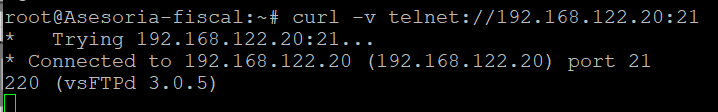
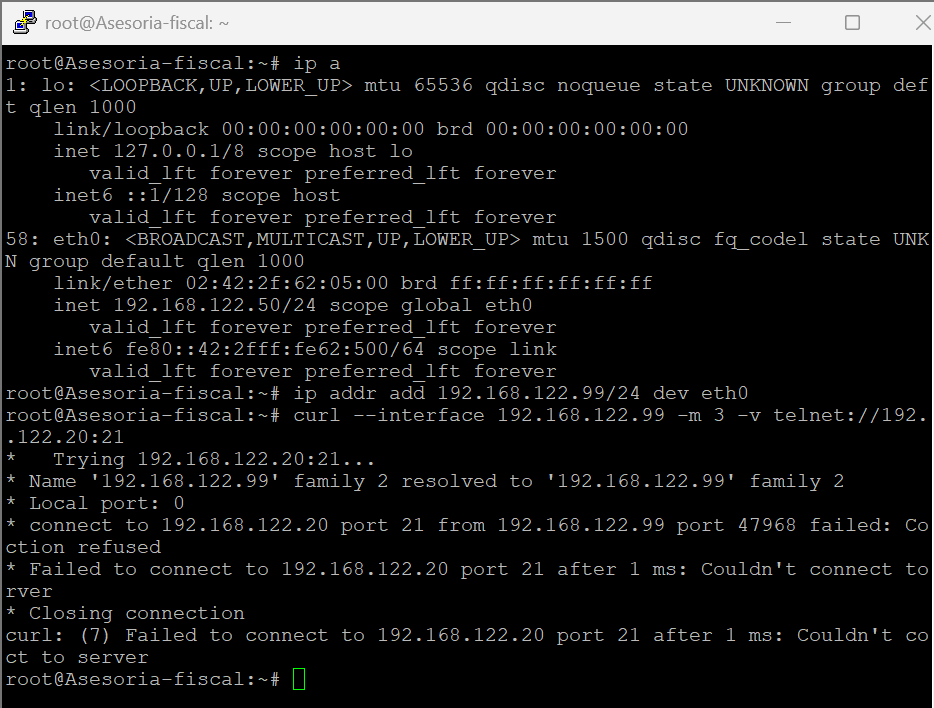
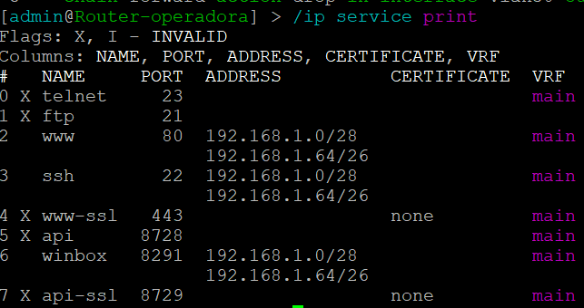

# Memoria Técnica de Implantación: Segmentación de Red y Seguridad

Este documento detalla los comandos y configuraciones aplicados durante la fase de implantación del proyecto en GNS3.

---

## 1. Configuración del Switch de Acceso 
**Dónde se aplica:** Consola del equipo `Switch-oficina`.

### 1.1 Creación de VLANs
Se definen tres dominios de difusión independientes para aislar el tráfico por departamentos.


enable
configure terminal

vlan 10
 name SERVIDORES
vlan 20
 name PLANTILLA
vlan 30
 name CLIENTES
exit

* **Explicación:** Separar la red lógicamente impide que un equipo comprometido en la sala de clientes (VLAN 30) pueda interceptar el tráfico de los empleados (VLAN 20) o atacar directamente al servidor (VLAN 10) mediante técnicas de Capa 2 (como ARP Spoofing).

### 1.2 Configuración del Enlace Troncal (Trunk)
El puerto que conecta con el router debe permitir el paso de todas las VLANs.


interface g0/0
 switchport trunk encapsulation dot1q
 switchport mode trunk
 switchport trunk allowed vlan 10,20,30
 exit

* **Explicación:** Se configura el puerto en modo `trunk` con encapsulación 802.1Q. Esto etiqueta las tramas Ethernet indicando a qué VLAN pertenecen antes de enviarlas al router, permitiendo que un solo cable físico transporte múltiples redes lógicas ("Router-on-a-stick").

### 1.3 Asignación de Puertos de Acceso
Se asignan los puertos físicos a sus respectivas VLANs de forma estática.


 Servidor (VLAN 10)
interface g0/1
 switchport mode access
 switchport access vlan 10
 exit

 Empleados e impresoras (VLAN 20)
interface g0/2
 switchport mode access
 switchport access vlan 20
interface g0/3
 switchport mode access
 switchport access vlan 20
interface g1/0
 switchport mode access
 switchport access vlan 20
interface g1/1
 switchport mode access
 switchport access vlan 20
interface g1/2
 switchport mode access
 switchport access vlan 20
 exit

 AP Clientes (VLAN 30)
interface g1/3
 switchport mode access
 switchport access vlan 30
 exit

 Guardar configuración
exit
write memory

---

## 2. Configuración del Router (MikroTik)
**Dónde se aplica:** Consola del equipo `Router-operadora`.

### 2.1 Limpieza y Enrutamiento Inter-VLAN
Se retira la IP de la antigua red plana y se configuran las puertas de enlace (Gateways) virtuales.


 1. Eliminar la red antigua del puerto físico
/ip address remove 0

 2. Crear las interfaces virtuales VLAN en el cable que va al switch (ether2)
/interface vlan
add interface=ether2 name=vlan10 vlan-id=10
add interface=ether2 name=vlan20 vlan-id=20
add interface=ether2 name=vlan30 vlan-id=30

 3. Asignar las direcciones IP calculadas por VLSM
/ip address
add address=192.168.1.1/28 interface=vlan10
add address=192.168.1.65/26 interface=vlan20
add address=192.168.1.129/26 interface=vlan30

* **Explicación VLSM:** Se ajustan las máscaras (`/28` para servidores y /26 para el resto) para no desperdiciar direcciones IP, ciñendo el tamaño de cada subred a sus necesidades reales de hosts.

### 2.2 Seguridad Perimetral: NAT Acotado (FTP)
Se permite el acceso desde el exterior para la Asesoría Fiscal, pero de forma restrictiva.


/ip firewall nat
add action=dst-nat chain=dstnat dst-port=21 in-interface=ether1 protocol=tcp src-address=192.168.122.50 to-addresses=192.168.1.10
add action=dst-nat chain=dstnat dst-port=40000-40050 in-interface=ether1 protocol=tcp src-address=192.168.122.50 to-addresses=192.168.1.10

* **Explicación:** En lugar de abrir el puerto 21 a todo Internet (lo que expondría el servidor a ataques de fuerza bruta constantes), la regla obliga a que la petición provenga exclusivamente de la IP origen `192.168.122.50` (Asesoría Fiscal). Si un atacante intenta conectar desde otra IP, el router ignorará la petición. El rango 40000-40050 se abre para permitir la transferencia de datos del protocolo FTP en modo pasivo.

### 2.3 Políticas de Cortafuegos (Firewall Filter)
Se aplican las reglas de aislamiento interno.


/ip firewall filter
 Permitir tráfico de empleados a servidor solo por HTTP y Samba
add action=accept chain=forward dst-port=80,445 in-interface=vlan20 out-interface=vlan10 protocol=tcp

 Bloquear cualquier otro intento desde empleados hacia servidor
add action=drop chain=forward in-interface=vlan20 out-interface=vlan10

 Bloquear tráfico desde clientes WiFi hacia servidor y empleados
add action=drop chain=forward in-interface=vlan30 out-interface=vlan10
add action=drop chain=forward in-interface=vlan30 out-interface=vlan20


---

## 3. Configuración de Equipos Finales

### 3.1 Servidor Ubuntu (`srv-mareas`)
**Dónde se aplica:** Terminal de Linux de `srv-mareas`.

Se configura Netplan para hacer permanente la nueva máscara y puerta de enlace.

bash
sudo nano /etc/netplan/01-gestoria.yaml

**Contenido del archivo:**
yaml
network:
  version: 2
  ethernets:
    ens3:
      addresses:
        - 192.168.1.10/28
      routes:
        - to: default
          via: 192.168.1.1
      nameservers:
        addresses: [8.8.8.8, 1.1.1.1]

bash
sudo netplan apply


### 3.2 Equipos Ligeros (VPCS)
**Dónde se aplica:** Consolas respectivas de `Movil-cliente`, `Impresora-1`, `Impresora-2`.

Se asigna IP, máscara y gateway, y se guardan en la memoria flash virtual.

text
 Movil-cliente (VLAN 30)
ip 192.168.1.130 255.255.255.192 192.168.1.129
save

 Impresora-1 (VLAN 20)
ip 192.168.1.66 255.255.255.192 192.168.1.65
save

 Impresora-2 (VLAN 20)
ip 192.168.1.67 255.255.255.192 192.168.1.65
save


### 3.3 Equipos de Escritorio
**Dónde se aplica:** Terminal de Linux (`Portatil`) y CMD como Administrador (`Puesto-1`, `Puesto-2`).

bash
 Portatil (Linux)
sudo ip addr flush dev ens3
sudo ip addr add 192.168.1.68/26 dev ens3
sudo ip route add default via 192.168.1.65


cmd
 Puesto-1 (Windows)
netsh interface ipv4 set address name="Ethernet" static 192.168.1.69 255.255.255.192 192.168.1.65

 Puesto-2 (Windows)
netsh interface ipv4 set address name="Ethernet" static 192.168.1.70 255.255.255.192 192.168.1.65


## 4. Bastionado Perimetral y Control de Acceso en el Router (MikroTik)

**Dónde se aplica:** Consola del equipo `Router-operadora`.

### 4.1 Permisos de Tráfico NAT y Estado en el Cortafuegos

Se añaden reglas de control de estado en la cadena `forward` del firewall para garantizar que las conexiones legítimas establecidas y el tráfico redirigido mediante NAT hacia el servidor FTP puedan fluir sin ser bloqueados por las políticas de aislamiento entre VLANs.

```routeros
/ip firewall filter
add chain=forward connection-state=established,related action=accept place-before=0 comment="Permitir trafico establecido"
add chain=forward connection-nat-state=dstnat action=accept place-before=1 comment="Permitir trafico redirigido por NAT (FTP Asesoria)"
```

* **Explicación:** Al colocar estas reglas al inicio de la cadena `forward`, el router permite el paso de paquetes pertenecientes a sesiones ya autorizadas y al reenvío de puertos de la Asesoría Fiscal (`dstnat`), manteniendo intacto el bloqueo hacia el resto de intentos de conexión no solicitados.

### 4.2 Deshabilitación de Servicios Inseguros y Acotación de Gestión

Se desactivan los servicios de administración propios del router que transmiten información en texto claro o no son necesarios, y se restringe el acceso a los servicios de gestión activos exclusivamente a las subredes de servidores (`VLAN 10`) y plantilla (`VLAN 20`).

```routeros
/ip service
disable telnet
disable ftp
disable api
disable api-ssl
set www address=192.168.1.0/28,192.168.1.64/26
set ssh address=192.168.1.0/28,192.168.1.64/26
set winbox address=192.168.1.0/28,192.168.1.64/26
```

* **Explicación:** Deshabilitar el servicio `ftp` interno del MikroTik evita conflictos con la redirección NAT del puerto 21 hacia el servidor Ubuntu y protege al router frente a ataques de fuerza bruta. Asimismo, limitar `www`, `ssh` y `winbox` a `192.168.1.0/28` y `192.168.1.64/26` impide que tanto atacantes externos desde Internet (`ether1`) como clientes conectados en la sala de espera (`VLAN 30 - 192.168.1.128/26`) puedan alcanzar las interfaces de administración del router.

---

## 5. Verificación de la Seguridad Perimetral (FTP Acotado)

**Dónde se aplica:** Consola del equipo externo `Asesoria-fiscal` (`192.168.122.50`).

### 5.1 Prueba de Acceso Autorizado (Asesoría Fiscal)

Se verifica que la Asesoría Fiscal externa mantiene operativa la comunicación con el servicio `vsftpd` del servidor interno a través de la IP WAN del router (`192.168.122.20`).

```bash
curl -v telnet://192.168.122.20:21
```

* **Resultado:** Conexión establecida correctamente con respuesta del banner del servidor (`220 (vsFTPd 3.0.5)`), confirmando que la operativa diaria de intercambio de archivos no se ve interrumpida.



### 5.2 Prueba de Bloqueo a Terceros Externos No Autorizados

Se asigna temporalmente una dirección IP secundaria (`192.168.122.99`) en la interfaz externa para simular un intento de intrusión desde cualquier otro origen de Internet distinto a la Asesoría Fiscal.

```bash
ip addr add 192.168.122.99/24 dev eth0
curl --interface 192.168.122.99 -m 3 -v telnet://192.168.122.20:21
ip addr del 192.168.122.99/24 dev eth0
```

* **Resultado:** Conexión rechazada (`Connection refused` / `Failed to connect to 192.168.122.20 port 21`), demostrando que el servicio FTP permanece cerrado e inaccesible para cualquier equipo externo cuya IP no coincida con la regla `src-address=192.168.122.50`.


---

## 6. Evidencias de la configuración de VLAN y del router

Las siguientes salidas de configuración fueron facilitadas por Hugo desde el laboratorio. Confirman la configuración mostrada, pero por sí solas no demuestran que todas las comunicaciones permitidas y bloqueadas funcionen; esas pruebas de conectividad se indican como pendientes al final de esta sección.

### 6.1 VLAN y puertos del switch

**Comandos ejecutados en `Switch-oficina`:**

```text
show vlan brief
show interfaces trunk
```

**Resultado observado:**

- VLAN 10 `SERVIDORES`, activa en `Gi0/1`.
- VLAN 20 `PLANTILLA`, activa en `Gi0/2`, `Gi0/3`, `Gi1/0`, `Gi1/1` y `Gi1/2`.
- VLAN 30 `CLIENTES`, activa en `Gi1/3`.
- `Gi0/0` está en modo trunk con encapsulación 802.1Q.
- El trunk permite las VLAN 10, 20 y 30, que aparecen activas y en estado de reenvío.

**Conclusión:** La salida confirma que las VLAN están creadas y que los puertos de acceso y el trunk están asignados según el diseño documentado.

### 6.2 Reglas NAT y de filtrado del router

**Comandos ejecutados en `Router-operadora`:**

```routeros
/ip firewall nat print detail
/ip firewall filter print detail
```

**Resultado observado:**

- La regla de `masquerade` proporciona NAT de salida por `ether1`.
- Hay una regla Destination NAT TCP para el puerto 21 hacia `192.168.1.10`, limitada a conexiones entrantes por `ether1` cuyo origen es `192.168.122.50`.
- Hay otra regla equivalente para el rango TCP `40000-40050`, también limitada a `192.168.122.50`.
- La primera regla de `forward` acepta conexiones `established,related`.
- Se permite desde `vlan20` hacia `vlan10` el tráfico TCP a los puertos 80 y 445.
- Se permite el tráfico con estado `dstnat`; las reglas NAT mostradas limitan las redirecciones FTP a la IP autorizada.
- Se descarta el resto del tráfico de `vlan20` hacia `vlan10` y el tráfico de `vlan30` hacia `vlan10` y `vlan20`.

**Conclusión:** La salida confirma las reglas configuradas. La prueba de acceso autorizado y la prueba desde otra IP están descritas en la sección 5.

**Observación:** La regla `connection-nat-state=dstnat` no especifica destino ni puerto. Actualmente depende de que las reglas Destination NAT estén restringidas correctamente; si se añaden nuevas redirecciones, hay que revisar que no se permita tráfico no previsto.


### 6.3 Servicios de administración del router

**Comando ejecutado en `Router-operadora`:**

```routeros
/ip service print
```

**Resultado observado:**

- Deshabilitados: Telnet, FTP, WWW-SSL, API y API-SSL.
- Activos y limitados a `192.168.1.0/28` y `192.168.1.64/26`: WWW, SSH y Winbox.

**Conclusión:** La salida confirma que los servicios de administración activos están limitados a las redes de servidores/gestión y plantilla. No muestra por sí sola el resultado de intentos de conexión desde VLAN 30 o desde la red externa.



### 6.4 Pruebas de conectividad inter-VLAN pendientes

Las salidas anteriores verifican la configuración, no la conectividad efectiva de los equipos. Falta adjuntar resultados de pruebas que confirmen:

- Desde un equipo de VLAN 30, que no se alcanza el servidor ni un puesto de VLAN 20 y que sí se conserva la salida a Internet.
- Desde un equipo de VLAN 20, que HTTP y Samba del servidor funcionan y que otros puertos no autorizados están bloqueados.
- Desde VLAN 30 y desde la red externa, que no se puede administrar el router por WWW, SSH o Winbox.

Añadir el equipo de origen, el destino, el comando usado y el resultado observado para cada prueba realizada.
